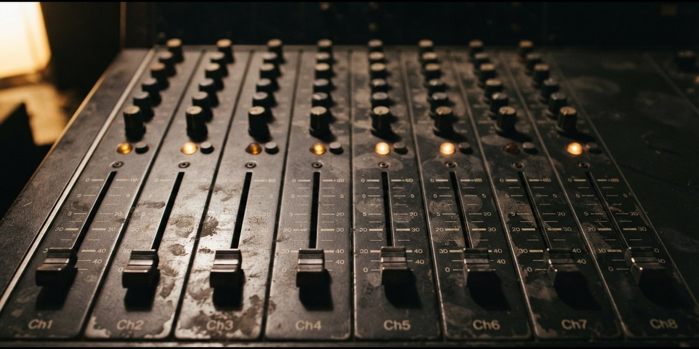

# Studio

Studio is a multitrack audio workstation that runs in the browser, in a single HTML file.

https://mauktenieb.github.io/studio/

## What it does

- Tracks with volume, pan, mute, solo, colour, order, duplication, and volume and pan automation.
- An effect rack per track, in any order: EQ, compressor, distortion, bitcrusher, chorus, flanger, phaser, tremolo, auto-pan, wah, filter, delay with ping-pong, reverb, vibrato, gate, ring modulator, frequency shifter (Hilbert), resonator, glitch buffer, vinyl, AM radio, room; ten chain presets (Voice, Radio, Telephone, Lo-fi, Robot, Space, Cathedral, Doubler, Noise wall, Dub).
- Clips that move, trim from both edges, fade in and out, split, duplicate, copy, paste, repeat, mute, rename and change track.
- Clip processing: reverse, normalize, gain, transpose with duration kept, speed change with pitch kept (WSOLA), denoise, bounce.
- Workshop (clip menu): Paulstretch, spectral freeze, spectral blur, spectral morph and cross-synthesis (vocoder) with a copied clip, granular brassage, shred, wavesets (repeat, omit, reverse, shuffle), stutter, circuit bend, tape stop, varispeed, reverse each beat, ring modulation and convolution with a copied clip.
- Master bus with its own effect rack and 23 mastering presets (Universal, Fire, Clarity, Tape, Warm, Punch, Bright, Loud, Wide, Vintage, Lo-fi, Bass boost, Vocal, Acoustic, Classical, Jazz, Hip-hop, EDM, Rock, Ambient, Podcast, Noise, Neutral): shelving EQ, three-band compression, tape saturation, stereo width, glue compression, limiter and soft clipper.
- Loudness targets measured in LUFS after ITU-R BS.1770 (K-weighting, gating): −9 club, −11 CD, −14 streaming, −16 Apple and podcast, −23 EBU R128, −24 ATSC A/85; the export iterates until the mix lands on the target, with the peak held under the preset ceiling.
- Room reverbs modelled from early reflections and frequency-dependent decay: closet, bathroom, kitchen, bedroom, living room, vocal booth, studio, classroom, car, stairwell, parking garage, club, theatre, concert hall, church, cathedral, cave, tunnel, plate, spring.
- Tempo, metronome, count-in, snap to the sixteenth, loop region drawn on the ruler, chromatic tuner, lyrics pad.
- Microphone recording onto the armed track, with optional input monitoring.
- Live search in Internet Archive, restricted to public domain, CC0, CC BY and CC BY-SA items, with seventeen listening categories: field recordings, city, forest, animals, factory, vehicles, firearms, voices, languages, ethnography, traditional music, chants, jazz, classical, concerts, oral history, sound effects. Freesound gets sixteen quick searches on the same themes.
- A built-in kit synthesized by the browser at load time: drums, basses, pads, drones, vinyl and radio noises, chaotic oscillators (Lorenz, logistic map, Hénon, Chua) and Polivoks-style voices.
- Live search in Freesound, restricted to CC0 and CC BY sounds.
- Import of any audio file the browser decodes.
- Export as WAV mix, MP3 mix or WAV stems, with a credits file listing every borrowed sound.
- Automatic saving of the project and its sounds in the browser (IndexedDB).
- Undo on every edit.

## Keys

Space plays and stops. R records. L toggles the loop. M toggles the metronome. S splits. D duplicates. Ctrl+C and Ctrl+V copy and paste. Arrows nudge the selected clip (Shift: a sixteenth). Delete removes the selected clip. Ctrl+Z undoes. Ctrl+wheel, + and − zoom. Right click or long press on a clip opens its menu.

## Sounds and licences

The built-in kit comes from Web Audio oscillators and noise, rendered offline at load time; it carries zero third-party rights.

Internet Archive items stream straight from archive.org. The studio skips the 78rpm and bootleg collections, whose public-domain labels rest on uploader statements disputed in court.

Freesound sounds stream through its official API. The studio shows CC0 and CC BY sounds only, and the export writes the credit line that CC BY requires. The file `worker.js` is a Cloudflare Worker that keeps the Freesound API key out of the public code. Without the worker, each user enters a personal key with the gear button, and the key stays in the user's browser.

## Code

Plain HTML, CSS and JavaScript, Web Audio API, zero dependencies. MIT licence.

---

## Français

Studio est une station audio multipiste qui tourne dans le navigateur, en un seul fichier HTML : pistes, clips, rack d'effets, automation, fondus, inversion, transposition, timestretch, master, accordeur, enregistrement au micro, kit synthétisé par le navigateur, recherche en direct dans Freesound (sons CC0 et CC BY) et dans Internet Archive (domaine public, CC0, CC BY, CC BY-SA), import de fichiers audio, export WAV, MP3 ou pistes séparées avec le fichier des crédits, sauvegarde automatique dans le navigateur.
